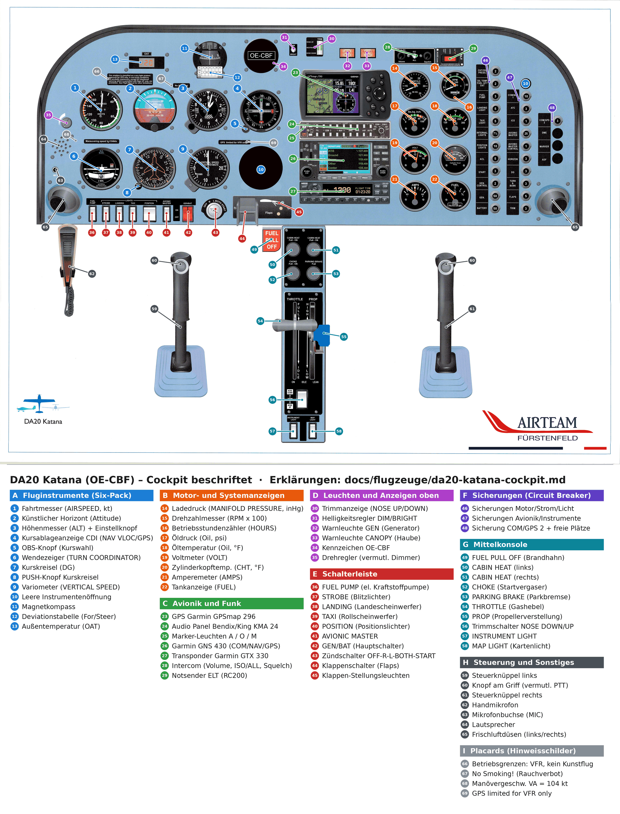

# DA20 Katana (OE-CBF) – das Cockpit erklärt

Grundlage ist das Cockpitposter des Airteam Fürstenfeld. Jede Nummer unten entspricht einem Marker im beschrifteten Bild.

- Gesamtbild: [da20-cockpit-beschriftet.png](../../media/da20-cockpit-beschriftet.png)
- Detailausschnitte: [Fluginstrumente](../../media/da20-cockpit-beschriftet-detail-instrumente.png) · [Avionik, Motoranzeigen, Sicherungen](../../media/da20-cockpit-beschriftet-detail-motor-avionik.png) · [Schalterleiste, Mittelkonsole, Steuerknüppel](../../media/da20-cockpit-beschriftet-detail-schalter-konsole.png)
- Original: [da20-cockpit-original.jpg](../../media/da20-cockpit-original.jpg)

> **Wichtig:** Das ist eine Lernhilfe, kein Ersatz für das Flughandbuch. Verbindlich sind das **AFM der OE-CBF**, die **Checkliste des Airteam** und die Einweisung durch deinen **Fluglehrer (FI)**. Das Poster ist eine Zeichnung: Einzelne Details (Beschriftungen, Farbbögen, Ausstattung) können vom echten Flugzeug abweichen. Grenzwerte, die als „am Bild abgelesen“ markiert sind, sind ungefähre Werte von der Skala; **[prüfen]** heißt: im AFM oder beim FI bestätigen lassen.

## Welche DA20-Variante ist das?

Die Anzeigen deuten klar auf eine **DA20-A1 Katana mit Rotax 912** und **Verstellpropeller** hin, nicht auf eine DA20-C1 mit Continental IO-240:

| Hinweis am Poster | Bedeutung |
|---|---|
| Tankanzeige: „Usable 74 L / 19.5 US gal“ | entspricht dem Tank der DA20-A1 (die C1 hat einen größeren Tank, ca. 24 US gal) |
| **CHOKE** an der Mittelkonsole | Startvergaser der Rotax-Vergaser (der Einspritzer IO-240 hat keinen Choke) |
| CHT-Rotstrich bei ca. 300 °F (≈ 150 °C) | Zylinderkopf-Grenze des Rotax 912; beim IO-240 läge sie deutlich höher |
| Drehzahlmesser rot bei ca. 2 500 | Propellerdrehzahl hinter dem Untersetzungsgetriebe des Rotax (Motor dreht ca. 2,27-mal schneller) |
| Ladedruckmesser + **PROP**-Hebel | Verstellpropeller mit Regler (Constant Speed); bei der DA20-A1 üblich (Hoffmann), die C1 hat einen Festpropeller |
| Kein Gemischhebel (Mixture) | Rotax-Gleichdruckvergaser regeln das Gemisch selbst |

Das passt auch zu den bestehenden Unterlagen (DA20 mit Rotax 912 in LOGF). Genaue Motorversion (z. B. 912 F3/S3) und Propellermuster: **[prüfen im AFM/Bordbuch]**.

**Alles läuft elektrisch:** Horizont, Kurskreisel und Wendezeiger haben eigene Sicherungen (HORIZON, DG, TURN & BANK). Es gibt keine Vakuumpumpe. Fällt die Elektrik aus, fallen also auch die Kreisel aus; Fahrtmesser, Höhenmesser, Variometer und Kompass funktionieren weiter.

---

## A – Fluginstrumente (Six-Pack)

Klassische Anordnung „Basic T“: oben Fahrt – Lage – Höhe, darunter Kurve – Kurs – Steigen/Sinken.

### 1 – Fahrtmesser (AIRSPEED, KNOTS)
- **Einfach erklärt:** Zeigt, wie schnell du durch die Luft fliegst (nicht über Grund), in Knoten.
- **Fachlich:** Misst die Differenz zwischen Staudruck (Pitotrohr) und statischem Druck und zeigt die angezeigte Geschwindigkeit IAS (Indicated Airspeed) in kt. Farbmarkierungen am Bild abgelesen (ca.):
  - **weißer Bogen** ca. 40–78 kt: Klappenbereich (untere Grenze ≈ Überziehgeschwindigkeit mit Landeklappen VS0, obere ≈ VFE für Landeklappen)
  - **grüner Bogen** ca. 44–118 kt: normaler Betriebsbereich (untere Grenze ≈ VS1, obere = VNO)
  - **gelber Bogen** ca. 118–161 kt: Vorsichtsbereich, nur in ruhiger Luft
  - **roter Strich** ca. 161 kt: VNE, nie überschreiten
- Für die DA20-A1 werden VNO 118 kt und VNE 161 kt genannt, das deckt sich mit den Farbbögen; VFE für die Startklappenstellung steht nicht auf dem Instrument. **[Alle Werte im AFM prüfen]**
- **Typische Fehler / Prüfung:** Pitotrohr-Abdeckung beim Vorflug nicht entfernt → keine Fahrtanzeige. Verstopfter Pitot → Fahrtmesser reagiert wie ein Höhenmesser. Fahrtmesser zeigt IAS, nicht TAS (Prüfungsfrage: IAS → CAS → TAS).

### 2 – Künstlicher Horizont (Attitude Indicator)
- **Einfach erklärt:** Zeigt dir Längsneigung (Nase hoch/runter) und Querneigung (Schräglage), auch wenn du draußen keinen Horizont siehst.
- **Fachlich:** Elektrisch angetriebener Kreisel (Sicherung HORIZON, 3 A). Oberer Rand: Querneigungsskala (Striche bei 10°, 20°, 30°, 60°); Mitte: Neigungsleitern 10° und 20°. Der Knopf unten verstellt das Flugzeugsymbol (vor dem Flug auf den Horizontstrich setzen).
- **Typische Fehler / Prüfung:** Braucht nach dem Einschalten einige Minuten zum Hochlaufen; vor dem Rollen prüfen, ob er ruhig und gerade steht. In VFR ist der Blick nach draußen die primäre Lagereferenz.

### 3 – Höhenmesser (ALT) mit Einstellknopf
- **Einfach erklärt:** Zeigt deine Höhe in Fuß. Am Knopf stellst du den aktuellen Luftdruck ein, damit die Anzeige stimmt.
- **Fachlich:** Barometrischer Höhenmesser (Dosen-/Aneroidprinzip), angeschlossen am statischen System. Drei Zeiger: 100 ft, 1 000 ft, 10 000 ft; das schraffierte Feld warnt vor niedriger Höhe. Im Fenster (Kollsman-Fenster) Druckskala in **mb/hPa** und **inHg**; mit dem Knopf links unten wird **QNH** (Höhe über MSL) oder QFE eingestellt. Aufschrift „Calibrated to 20,000 feet“.
- **Typische Fehler / Prüfung:** QNH vor dem Start einstellen und mit Platzhöhe vergleichen (LOGF: 830 ft); Differenz über ca. ±75 ft **[prüfen: Toleranz laut Schule/AFM]** → Instrument nicht verlässlich. Merksatz: „Vom Hoch ins Tief geht's schief“ (der Höhenmesser zeigt dann zu viel an).

### 4 – Kursablageanzeige CDI (NAV, VLOC/GPS)
- **Einfach erklärt:** Zeigt mit einer senkrechten Nadel, ob du links oder rechts vom gewählten Kurs zu einem Funkfeuer (VOR) oder GPS-Wegpunkt bist.
- **Fachlich:** Anzeige für das Garmin GNS 430 (Nr. 26). Die Beschriftung „NAV VLOC / GPS“ zeigt, welche Quelle angezeigt wird (umschalten mit der CDI-Taste am GNS 430). Senkrechte Nadel = Kursablage, TO/FROM-Anzeige, horizontale Nadel = Gleitweg (nur ILS, für VFR nicht relevant), rote Flaggen = kein gültiges Signal.
- **Typische Fehler / Prüfung:** Nadel „in die Richtung der Nadel fliegen“, um zurück auf Kurs zu kommen (bei richtiger TO/FROM-Einstellung). Prüfung: VOR-Radial bestimmen, TO/FROM-Mehrdeutigkeit.

### 5 – OBS-Knopf (Omni Bearing Selector)
- **Einfach erklärt:** Drehknopf, mit dem du den gewünschten Kurs auf der Rose der Kursanzeige einstellst.
- **Fachlich:** Stellt den Kurs (Radial) am CDI ein. Im GPS-Modus wird der Kurs meist vom GNS 430 vorgegeben (Taste OBS am GNS für manuelle Kurswahl).

### 6 – Wendezeiger (TURN COORDINATOR, „D.C. ELEC.“)
- **Einfach erklärt:** Das kleine Flugzeug zeigt, wie schnell du kurvst; die Kugel zeigt, ob du sauber („koordiniert“) fliegst.
- **Fachlich:** Elektrischer Kreisel (Sicherung TURN & BANK, 3 A). Neigt sich das Symbol bis zur Marke L oder R, fliegst du eine **Standardkurve (Rate One, 3°/s = 360° in 2 Minuten, „2 MIN.“)**. Die **Kugel (Libelle)** zeigt Schieben oder Schmieren: Kugel nicht in der Mitte → „ins Seitenruder treten, wo die Kugel ist“ („step on the ball“). „NO PITCH INFORMATION“: zeigt keine Längsneigung. Die rote **OFF**-Flagge erscheint ohne Strom.
- **Prüfung:** Beim Rollen nach links und rechts testen: Symbol neigt sich in Kurvenrichtung, Kugel wandert nach außen.

### 7 – Kurskreisel (Directional Gyro, DG)
- **Einfach erklärt:** Zeigt deinen Steuerkurs wie ein Kompass, aber ruhig und ohne Drehfehler.
- **Fachlich:** Elektrischer Kreisel (Sicherung DG, 3 A) mit Kompassrose und Flugzeugsymbol. Hat keinen eigenen Nordbezug und **driftet (Präzession)**, muss also regelmäßig mit dem Magnetkompass abgeglichen werden (vor dem Start und etwa alle 15 Minuten **[Intervall: Lehrmeinung, beim FI bestätigen]**), im Geradeaus- und unbeschleunigten Flug.

### 8 – PUSH-Knopf am Kurskreisel
- **Einfach erklärt:** Hineindrücken und drehen, um den Kurskreisel auf den Kompasskurs zu stellen.
- **Fachlich:** Einstellknopf für die Kursrose (bei manchen Geräten auch für eine Kursmarke, „Heading Bug“). **[prüfen: Funktion am echten Gerät]**

### 9 – Variometer (VERTICAL SPEED, 100 feet per minute)
- **Einfach erklärt:** Zeigt, ob und wie schnell du steigst oder sinkst.
- **Fachlich:** Misst die Änderung des statischen Drucks über eine Kapillare (Ausgleichsgefäß). Skala in 100 ft/min, bis 2 000 ft/min (UP = steigen, DOWN = sinken). Hat eine Verzögerung von einigen Sekunden, deshalb zuerst Fluglage halten, dann das Vario ablesen.

### 10 – Leere Instrumentenöffnung(en)
- **Einfach erklärt:** Platzhalter ohne Instrument.
- **Fachlich:** Unten rechts im Six-Pack und neben den Sicherungen sind am Poster leere Öffnungen. Dort könnten bei anderer Ausstattung z. B. ein zweites NAV-Instrument oder ADF sitzen. Im echten Flugzeug kann hier etwas eingebaut sein. **[prüfen am Flugzeug]**

### 11 – Magnetkompass
- **Einfach erklärt:** Der einfache „Notfallkompass“, der auch ohne Strom funktioniert.
- **Fachlich:** Schwimmkompass mit Kompassrose (E, 6, 3, N … in 10°-Schritten ohne letzte Null). Zeigt den **Kompasskurs**. Fehler: **Deviation** (Störfelder im Flugzeug, siehe Nr. 12), **Beschleunigungs- und Drehfehler** (auf der Nordhalbkugel: beim Beschleunigen auf Ost-/Westkurs Drehung nach Norden; in Kurven durch Nord „nachlaufend“, durch Süd „voreilend“).
- **Prüfung:** Kompassfehler sind ein Klassiker in „Allgemeine Luftfahrzeugkenntnisse“ und „Navigation“.

### 12 – Deviationstabelle (For / Steer)
- **Einfach erklärt:** Kleiner Zettel unter dem Kompass: Welchen Kompasskurs musst du fliegen, um einen bestimmten Kurs zu bekommen.
- **Fachlich:** Ablenkungstabelle aus der Kompasskompensierung. „For“ = gewünschter missweisender Kurs (N, 30, 60, E …), „Steer“ = zu steuernder Kompasskurs. Am Poster sind keine Werte eingetragen; im Flugzeug gilt die aktuelle Tabelle mit Datum.

### 13 – Außentemperaturanzeige (OAT)
- **Einfach erklärt:** Zeigt die Temperatur draußen (am Poster +20).
- **Fachlich:** Digitale Anzeige, vermutlich in °C **[prüfen]** (Sicherung gemeinsam mit Öltemperatur und Tankanzeige, siehe Nr. 46). Wichtig für Dichtehöhe/Leistung, Vereisungsgefahr (Vergaservereisung ist bei feuchter Luft zwischen ca. −10 und +30 °C möglich) und Gefrierniveau.

---

## B – Motor- und Systemanzeigen

### 14 – Ladedruckmesser (MANIFOLD PRESSURE, IN HG)
- **Einfach erklärt:** Zeigt, wie viel „Luftdruck“ hinter der Drosselklappe ankommt – zusammen mit der Drehzahl ein Maß für die Motorleistung.
- **Fachlich:** Absolutdruck im Ansaugrohr in inHg (Skala 10–35). Mit Verstellpropeller wird die Leistung über **Ladedruck (Gashebel)** und **Drehzahl (Propellerhebel)** eingestellt. Bei stehendem Motor zeigt er ungefähr den Umgebungsdruck (ca. 29 inHg in LOGF). Am Poster keine Farbmarkierungen; Leistungseinstellungen laut AFM-Leistungstabelle. **[prüfen]**
- **Typischer Fehler:** Bei Verstellpropeller beim Leistungserhöhen erst Drehzahl (PROP) hoch, dann Ladedruck (THROTTLE); beim Reduzieren umgekehrt („Prop first up, throttle first down“) – ob das AFM das für die DA20-A1 so vorgibt **[prüfen]**.

### 15 – Drehzahlmesser (RPM x 100)
- **Einfach erklärt:** Zeigt, wie schnell sich der Propeller dreht.
- **Fachlich:** Beim Rotax 912 mit Getriebe wird im DA20-A1 die **Propellerdrehzahl** angezeigt **[prüfen]**. Am Bild abgelesen (ca.): grüner Bogen ca. 1 000–2 400, gelber Bogen ca. 2 400–2 500 (zeitlich begrenzte Startleistung), roter Strich ca. 2 500. Exakte Grenzwerte (Startleistung, max. Dauerleistung, Zeitlimit) laut AFM.
- **Prüfung:** Beim Run-up ablesen (Zündungs- und Propellercheck).

### 16 – Betriebsstundenzähler (HOURS)
- **Einfach erklärt:** Zählt die Motorstunden (am Poster 0068x,x).
- **Fachlich:** Im Drehzahlmesser eingebauter Zähler, der drehzahlabhängig zählt. Grundlage für Wartungsintervalle und eventuell für die Abrechnung. Wird vor und nach dem Flug ins Bordbuch eingetragen.

### 17 – Öldruck (Oil, lbs./sq. inch)
- **Einfach erklärt:** Zeigt, ob der Motor genug Öl mit Druck bekommt. Geht der Zeiger nach dem Start nicht hoch: Motor sofort abstellen.
- **Fachlich:** Skala 0–150 psi. Am Bild abgelesen (ca.): rote Marke unten (Mindestdruck), grüner Bogen ca. 30–80 psi, gelber Bogen ca. 80–100 psi, rote Marke oben ca. 100 psi. Rotax 912 laut Herstellerangaben: normal ca. 2–5 bar (≈ 29–73 psi), Minimum 0,8 bar (≈ 12 psi), Maximum 7 bar (≈ 100 psi, nur kurz beim Kaltstart). **[Werte im AFM prüfen]**
- **Prüfung:** Öldruck nach dem Anlassen innerhalb ca. 10 Sekunden kontrollieren **[prüfen: Zeit laut AFM]**. Der Rotax 912 hat einen Trockensumpf: Ölstand nach dem „Durchdrehen“ des Propellers prüfen (Gurgeln im Öltank), nur so wie vom FI gezeigt und mit Zündung AUS.

### 18 – Öltemperatur (Oil, °F)
- **Einfach erklärt:** Zeigt, wie warm das Motoröl ist. Zu kalt: noch keine Vollgasstarts. Zu heiß: Motor wird zu stark belastet.
- **Fachlich:** Skala 120–300 °F. Am Bild abgelesen (ca.): rote Marke bei ca. 120 °F (Mindesttemperatur), grüner Bogen bis ca. 285 °F, rote Marke bei ca. 285–290 °F. Das passt zum Rotax (min. 50 °C ≈ 120 °F, max. 140 °C ≈ 285 °F). **[AFM prüfen]**
- **Prüfung:** Run-up erst, wenn die Öltemperatur die Mindestmarke erreicht hat.

### 19 – Voltmeter (VOLT)
- **Einfach erklärt:** Zeigt die Spannung im Bordnetz. Grün = der Generator lädt.
- **Fachlich:** Skala 8–16 V (12-V-System). Am Bild abgelesen (ca.): rot 8–11 V, gelb ca. 11–12,5 V (Batterie wird nicht geladen), grün ca. 12,5–15,5 V (Generator lädt, typisch ca. 14 V), rot ab ca. 16 V (Überspannung).
- **Prüfung:** Nach dem Start Spannung im grünen Bereich? Sonst Generatorausfall (siehe GEN-Leuchte Nr. 32).

### 20 – Zylinderkopftemperatur (Cylinder Head Temp., CHT, °F)
- **Einfach erklärt:** Zeigt, wie heiß die Zylinderköpfe werden.
- **Fachlich:** Skala ca. 100–600 °F, roter Strich am Bild bei ca. 300 °F (≈ 150 °C). Beim Rotax 912 sind die Zylinderköpfe flüssigkeitsgekühlt. Hohe CHT bei langen Steigflügen mit wenig Fahrt → Fahrt erhöhen (flacher steigen), Leistung reduzieren. **[Grenzwert im AFM prüfen]**

### 21 – Amperemeter (AMPS)
- **Einfach erklärt:** Zeigt, ob die Batterie geladen (+) oder entladen (−) wird.
- **Fachlich:** Nullpunkt in der Mitte, Skala −60 bis +60 A. Nach dem Anlassen deutlich im Plus (Batterie wird nachgeladen), dann nahe null bis leicht plus. Dauerhaft im Minus → Generator lädt nicht, die Batterie liefert allen Strom; Verbraucher reduzieren und landen.

### 22 – Tankanzeige (FUEL, Usable 74 L / 19.5 US gal)
- **Einfach erklärt:** Zeigt, wie voll der Tank ist (0 – ¼ – ½ – ¾ – voll).
- **Fachlich:** Elektrische Anzeige für den einen Rumpftank. Laut Placard **74 Liter (19,5 US gal) ausfliegbar**. Rote Marke bei 0. Tankanzeigen sind ungenau – **vor dem Flug immer per Sicht/Messstab prüfen** und die Kraftstoffmenge über Zeit und Verbrauch planen. Zulässige Kraftstoffsorten laut AFM **[prüfen]**.
- **Prüfung:** Kraftstoffplanung inkl. Reserve; Tankanzeige ist kein Ersatz für die Berechnung.

---

## C – Avionik und Funk

### 23 – GPS Garmin GPSmap 296
- **Einfach erklärt:** Tragbares Navi für Flugzeuge mit Karte, Kurs und Geschwindigkeit über Grund.
- **Fachlich:** Zeigt Moving Map, Distanz zum nächsten Wegpunkt (DIST NEXT), Geschwindigkeit über Grund (SPEED), Restflugzeit (ETE NEXT) und Querablage (CROSS TRK). Tasten: PAGE, QUIT, ENTER, MENU, NRST (nächstgelegene Plätze), Steuerkreuz, Zoom IN/OUT, Ein/Aus. Nur als Hilfsmittel für VFR (siehe Placard Nr. 69); Luftraumdaten müssen aktuell sein.

### 24 – Audio Panel Bendix/King KMA 24
- **Einfach erklärt:** Hier wählst du, welches Funkgerät du hörst und mit welchem du sendest.
- **Fachlich:** Obere Tastenreihe „SPEAKER“ (Lautsprecher), untere „PHONE“ (Headset) für TEL, COM 1, COM 2, NAV 1, NAV 2, DME, MKR, ADF, AUTO. Wahlschalter rechts: **COM 1 / COM 2** (Sender für das Mikrofon), TEL, INT (Intercom), EXT, OFF. In der DA20 ist COM 1 das GNS 430; ob ein COM 2 eingebaut ist (Sicherung „COM/GPS 2“), **[am Flugzeug prüfen]**.
- **Typischer Fehler:** Falsches COM gewählt → man sendet auf der falschen Frequenz oder hört nichts.

### 25 – Marker-Leuchten A / O / M
- **Einfach erklärt:** Drei Lämpchen, die beim ILS-Anflug über bestimmten Punkten blinken – in der VFR-Ausbildung nicht wichtig.
- **Fachlich:** Teil des KMA 24. **O** (Outer Marker, blau), **M** (Middle Marker, gelb), **A** (Airway/Inner Marker, weiß). Schalter HI/LO/TEST für Empfindlichkeit und Lampentest.

### 26 – Garmin GNS 430 (COM / NAV / GPS)
- **Einfach erklärt:** Das Hauptfunkgerät mit eingebautem GPS: Funken, VOR empfangen und navigieren.
- **Fachlich:**
  - Links oben: **C** = COM-Lautstärke (drücken = Squelch aus), **V** = VLOC-Lautstärke (drücken = Morsekennung hören).
  - Links: Flip-Flop-Tasten **C** und **V** (aktive ↔ Standby-Frequenz tauschen); großer/kleiner Drehknopf **COM/VLOC** zum Einstellen, **PUSH C/V** schaltet zwischen COM- und NAV-Feld.
  - Anzeige links: COM aktiv (oben, z. B. 121.900) und Standby, VLOC aktiv und Standby; ENR/INTEG = GPS-Statusmeldungen.
  - Rechts: RNG (Kartenmaßstab), **Direct-To** (→D), MENU, CLR, ENT, Drehknopf **PUSH CRSR** (Seiten wählen, Cursor).
  - Unten: **CDI** (schaltet die Kursanzeige Nr. 4 zwischen GPS und VLOC), OBS, MSG (Meldungen), FPL (Flugplan), PROC (Anflugverfahren, IFR).
- **Prüfung:** Frequenz zuerst ins Standby-Feld, dann tauschen; Notfrequenz 121.500 kennen.

### 27 – Transponder Garmin GTX 330
- **Einfach erklärt:** Antwortet auf Radarabfragen, damit die Flugsicherung dich mit Code und Höhe sieht.
- **Fachlich:** Mode-S-Transponder. Drehwahlschalter **OFF – STBY – ON – ALT** (ALT = mit Höhenübermittlung, im Flug Standard). Tasten **IDENT** (nur auf Aufforderung „squawk ident“), **VFR** (setzt den VFR-Code; in Österreich **7000**), Zifferntasten 0–7 für den Squawk, FUNC, CRSR, START/STOP (Flugzeituhr), CLR. Das Poster zeigt 1200 – das ist der US-VFR-Code, in Österreich gilt 7000.
- **Prüfung:** **7500** Entführung, **7600** Funkausfall, **7700** Notfall. Vor dem Abrollen/Start auf ALT, nach dem Landen auf STBY (laut Schulvorgabe **[prüfen]**).

### 28 – Intercom (Push-On Volume, ISO/ALL, Squelch)
- **Einfach erklärt:** Bordsprechanlage, damit du dich mit dem Fluglehrer über das Headset unterhalten kannst.
- **Fachlich:** **Volume** (drücken = ein, drehen = Lautstärke), Kippschalter **ISO/ALL** (ISO = Pilot hört nur den Funk, nicht den Mitflieger; ALL = alle hören alles), **Squelch** (Schwelle, ab der das Mikrofon öffnet). Sicherung ICS (1 A).
- **Typischer Fehler:** Squelch zu hoch → Sprache wird abgeschnitten; zu niedrig → ständiges Rauschen.

### 29 – Notsender ELT (Bedienteil RC200)
- **Einfach erklärt:** Notsender, der nach einem Unfall automatisch ein Notsignal aussendet. Normalerweise immer auf ARMED lassen.
- **Fachlich:** Fernbedienung für den ELT (Emergency Locator Transmitter). Schalterstellungen **ON** (manuell auslösen), **ARMED** (Normalstellung, löst bei Aufprall aus), **RESET/TEST**. Rote Leuchte zeigt aktives Senden. Placard: „For aviation emergency use only – unauthorized operation prohibited.“ Sendefrequenzen und Testregeln laut ELT-Handbuch **[prüfen]**.
- **Prüfung:** Nach harter Landung oder am Ende des Flugs auf 121.500 hineinhören, ob der ELT versehentlich sendet.

---

## D – Leuchten und Anzeigen oben

### 30 – Trimmanzeige (TRIM: NOSE UP / NEUTRAL / NOSE DOWN)
- **Einfach erklärt:** Leuchtbalken, der zeigt, wie die Höhenrudertrimmung steht.
- **Fachlich:** LED-Anzeige der elektrischen Trimmung (bedient mit Nr. 56, Sicherung TRIM 3 A). Für den Start auf **NEUTRAL bzw. Startstellung** laut Checkliste.
- **Typischer Fehler:** Trimmung beim Start voll auf „Nose up“ → das Flugzeug steigt steil und unerwartet; daher ist „Trim – T/O“ ein fester Checklistenpunkt.

### 31 – Helligkeitsregler DIM / BRIGHT
- **Einfach erklärt:** Drehknopf, um Leuchten heller oder dunkler zu machen.
- **Fachlich:** Dimmer, vermutlich für Warnleuchten und Trimmanzeige (Nachtflug). Genaue Zuordnung **[prüfen am Flugzeug]**.

### 32 – Warnleuchte GEN (Generator)
- **Einfach erklärt:** Leuchtet rot, wenn der Generator keinen Strom liefert.
- **Fachlich:** Leuchtet vor dem Anlassen (Motor steht), muss nach dem Anlassen ausgehen. Leuchtet sie im Flug: Voltmeter/Amperemeter prüfen, Verfahren „Generator Failure“ laut AFM (GEN-Schalter/Sicherungen prüfen, nicht benötigte Verbraucher aus, baldmöglichst landen). Die kleinere Schrift auf der Leuchte ist am Poster nicht lesbar; vermutlich ist es ein Taster zum Lampentest **[prüfen]**.

### 33 – Warnleuchte CANOPY (Haube)
- **Einfach erklärt:** Leuchtet, wenn die Kabinenhaube nicht richtig verriegelt ist.
- **Fachlich:** Vor dem Rollen muss die Haube geschlossen, verriegelt und die Leuchte aus sein. Eine im Flug öffnende Haube ist ein bekannter DA20-Gefahrenpunkt → Notverfahren laut AFM (Ruhe bewahren, fliegen, Fahrt reduzieren, landen) **[prüfen]**.

### 34 – Kennzeichen OE-CBF
- **Einfach erklärt:** Das Rufzeichen des Flugzeugs.
- **Fachlich:** Österreichisches Eintragungszeichen (OE- = Österreich; OE-C… gehört zur Gruppe der einmotorigen Flugzeuge, siehe Skript Luftrecht, Kapitel 3). Funk: „Oscar Echo Charlie Bravo Foxtrot“, Kurzform nach Erstkontakt „OE-CBF“ bzw. „Oscar Bravo Foxtrot“ **[Kurzrufzeichen laut Schulvorgabe]**.

### 35 – Drehregler links vom Fahrtmesser
- **Einfach erklärt:** Drehknopf mit weißem Bogen – wahrscheinlich ein Helligkeitsregler.
- **Fachlich:** Am Poster unbeschriftet; der weiße Bogen deutet auf einen stufenlosen Regler, vermutlich die Instrumentenbeleuchtung (passend zum Schalter INSTRUMENT LIGHT, Nr. 57). **[prüfen am Flugzeug]**

---

## E – Schalterleiste

Alle Kippschalter: **oben = ON, unten = OFF** (Markierung neben AVIONIC MASTER).

### 36 – FUEL PUMP (elektrische Kraftstoffpumpe)
- **Einfach erklärt:** Zusätzliche elektrische Pumpe, falls die Motorpumpe ausfällt.
- **Fachlich:** Ergänzt die mechanische Kraftstoffpumpe des Motors. Üblich: **ON für Anlassen, Start und Landung** sowie bei Kraftstoffdruckproblemen, im Reiseflug je nach AFM aus. Sicherung FUEL PUMP 3 A. **[Verwendung laut AFM/Checkliste prüfen]**

### 37 – STROBE (Blitzlichter / Antikollisionslichter)
- **Einfach erklärt:** Weiße Blitzlichter an den Flügelspitzen, damit dich andere sehen.
- **Fachlich:** Antikollisionslicht (Sicherung ACL 5 A). Typisch ON ab Anlassen bzw. vor Betreten der Piste **[Schulvorgabe]**; in Wolken oder Dunst kann das Blitzen blenden.

### 38 – LANDING (Landescheinwerfer)
- **Einfach erklärt:** Starker Scheinwerfer für Start und Landung.
- **Fachlich:** Sicherung LANDING LIGHT 5 A. Wird tagsüber oft zur besseren Erkennbarkeit beim Start, in der Platzrunde und im Anflug eingeschaltet.

### 39 – TAXI (Rollscheinwerfer)
- **Einfach erklärt:** Scheinwerfer zum Rollen am Boden.
- **Fachlich:** Sicherung TAXI LIGHT 5 A. Beim Rollen ON, vor allem nachts und bei schlechter Sicht.

### 40 – POSITION (Positionslichter)
- **Einfach erklärt:** Rot links, grün rechts, weiß hinten – damit andere sehen, in welche Richtung du fliegst.
- **Fachlich:** Navigationslichter (Sicherung POSITION LIGHTS 10 A). Pflicht bei Nacht. Merksatz: „Rot links, grün rechts“.

### 41 – AVIONIC MASTER
- **Einfach erklärt:** Schaltet alle Funk- und Navigationsgeräte gemeinsam ein oder aus.
- **Fachlich:** Schaltet über ein Relais (Sicherungen AVIONIC MASTER 25 A und AVIONIC MASTER CONTROL 1 A) die Avionikschiene. **Beim Anlassen und Abstellen OFF**, damit Spannungsspitzen die Geräte nicht beschädigen.

### 42 – GEN/BAT (Hauptschalter, geteilter roter Schalter)
- **Einfach erklärt:** Der Hauptschalter für Strom: Batterie (BAT) und Generator (GEN).
- **Fachlich:** Geteilter Kippschalter. **BAT** verbindet die Batterie mit dem Bordnetz, **GEN** schaltet das Erregerfeld des Generators (Sicherungen GEN 50 A, GEN CONTROL 2 A, BATTERY 50 A). Üblicherweise lässt sich GEN nur zusammen mit BAT einschalten; BAT allein ist möglich **[am Flugzeug prüfen]**.
- **Prüfung:** Nach dem Flug **beide AUS** – sonst ist die Batterie am nächsten Tag leer. Bei Elektrikbrand: Master AUS.

### 43 – Zündschalter (OFF – R – L – BOTH – START)
- **Einfach erklärt:** Zündschloss mit Schlüssel. BOTH = normaler Betrieb, START = Anlasser.
- **Fachlich:** Der Rotax 912 hat eine doppelte elektronische Zündung (zwei unabhängige Kreise, im Sprachgebrauch „Magnete“). **R/L** = nur ein Zündkreis (für den Zündungscheck beim Run-up), **BOTH** = beide, **START** = federbelasteter Anlasserkontakt (Sicherung START 3 A). Zulässiger Drehzahlabfall und Differenz zwischen L und R laut AFM **[prüfen]**.
- **Prüfung:** Zündungscheck: kein Abfall = Verdacht auf fehlende Erdung (Motor könnte auch bei OFF anspringen) → Propeller immer als „scharf“ behandeln. Nach dem Abstellen Schlüssel abziehen.

### 44 – Klappenschalter (Flaps)
- **Einfach erklärt:** Hebel, mit dem du die Landeklappen ausfährst (mehr Auftrieb bei wenig Fahrt).
- **Fachlich:** Elektrische Landeklappen (Sicherung FLAPS 5 A) mit drei Stellungen: **UP (Reise), T/O (Start), LDG (Landung)**. Nur unterhalb der zugehörigen VFE fahren (weißer Bogen, Nr. 1). **[Stellungen und VFE im AFM prüfen]**

### 45 – Klappen-Stellungsleuchten
- **Einfach erklärt:** Drei Lämpchen zeigen, in welcher Stellung die Klappen gerade stehen.
- **Fachlich:** Eine Leuchte je Stellung (am Poster: oben grün, darunter zwei gelb). Vermutlich grün = UP, gelb = T/O und LDG. Leuchtet keine, laufen die Klappen gerade oder es gibt eine Störung. **[Zuordnung am Flugzeug prüfen]**

---

## F – Sicherungen (Circuit Breaker)

- **Einfach erklärt:** Jede Sicherung schützt einen Stromkreis. Bei Überlast springt der Knopf heraus. Die Zahl ist die Stromstärke in Ampere.
- **Fachlich:** Herausgesprungene Sicherung **höchstens einmal** nach kurzer Abkühlzeit wieder hineindrücken; springt sie erneut, **nicht festhalten oder wiederholt drücken** (Brandgefahr). Ein Sicherungsautomat wird nicht zum Schalten verwendet. Beim Vorflug-Check im Cockpit: alle Sicherungen drin?

### 46 – Spalte 1: Motoranzeigen, Strom, Licht

| Beschriftung | A | Was sie schützt |
|---|---|---|
| CHT/OIL PRESS. | 2 | Zylinderkopftemperatur und Öldruck (Nr. 17, 20) |
| OIL TEMP / FUEL QTY / OAT | 2 | Öltemperatur, Tankanzeige, Außentemperatur (Nr. 13, 18, 22) |
| FUEL PUMP | 3 | elektrische Kraftstoffpumpe (Nr. 36) |
| LANDING LIGHT | 5 | Landescheinwerfer (Nr. 38) |
| TAXI LIGHT | 5 | Rollscheinwerfer (Nr. 39) |
| INTERNAL LIGHTS | 7½ | Innenbeleuchtung (Instrument/Map Light, Nr. 57, 58) |
| POSITION LIGHTS | 10 | Positionslichter (Nr. 40) |
| ACL | 5 | Anti-Collision Light = Strobes (Nr. 37) |
| START | 3 | Steuerkreis des Anlasserrelais (Nr. 43) |
| GEN. CONTROL | 2 | Generatorregelung/Erregung (Nr. 42) |
| GEN. | 50 | Generator-Hauptleitung |
| BATTERY | 50 | Batterie-Hauptleitung |

### 47 – Spalte 2: Avionik und Kreiselinstrumente

| Beschriftung | A | Was sie schützt |
|---|---|---|
| COM/NAV 1 | 10 | Garmin GNS 430 (Nr. 26) |
| ATC | 3 | Transponder GTX 330 (Nr. 27) |
| ICS | 1 | Intercom (Nr. 28) |
| AVIONIC MASTER | 25 | Avionikschiene (Nr. 41) |
| AVIONIC MASTER CONTROL | 1 | Steuerkreis des Avionik-Relais |
| HORIZON | 3 | künstlicher Horizont (Nr. 2) |
| DG | 3 | Kurskreisel (Nr. 7) |
| TURN & BANK | 3 | Wendezeiger (Nr. 6) |
| FLAPS | 5 | Klappenmotor (Nr. 44) |
| TRIM | 3 | elektrische Trimmung (Nr. 30, 56) |

### 48 – Spalte 3: COM/GPS 2 und freie Plätze

| Beschriftung | A | Was sie schützt |
|---|---|---|
| COM/GPS 2 | 3 | zweites COM bzw. GPS (z. B. Stromversorgung GPSmap 296) **[prüfen]** |
| DME, MARKER, ADF | – | am Poster ohne Sicherung (schwarze Felder) = nicht eingebaut |

---

## G – Mittelkonsole

### 49 – FUEL PULL OFF (Kraftstoffabsperrhahn, „Brandhahn“)
- **Einfach erklärt:** Roter Griff: Ziehen = Kraftstoff zum Motor zu.
- **Fachlich:** Im Normalbetrieb **eingeschoben (offen)**. Ziehen sperrt die Kraftstoffzufuhr – bei **Motorbrand** oder Notlandung laut Notverfahren. Der Motor läuft danach noch kurz mit dem Restkraftstoff weiter.
- **Prüfung:** Vor dem Anlassen kontrollieren, ob der Hahn offen ist (häufige Ursache für „Motor springt an und stirbt nach kurzer Zeit ab“).

### 50 – CABIN HEAT (links, „Pull – ON“)
- **Einfach erklärt:** Ziehen = warme Luft in die Kabine.
- **Fachlich:** Steuert die Heizklappe am Wärmetauscher um den Auspuff. Bei Brandgeruch im Cockpit oder Verdacht auf Kohlenmonoxid (CO): Heizung zu, Frischluft auf.

### 51 – CABIN HEAT (rechts, „Pull – ON“)
- **Einfach erklärt:** Zweiter Heizungszug.
- **Fachlich:** Am Poster gleich beschriftet wie Nr. 50. Im echten Flugzeug ist das oft ein zweiter Zug für Luftverteilung bzw. Scheibenheizung (Defrost) oder eine Vergaservorwärmung (Carb Heat). **[Funktion unbedingt am Flugzeug/beim FI klären]**. Eine Vergaservorwärmung ist am Poster sonst nicht zu sehen.

### 52 – CHOKE (Startvergaser, „Pull – ON“)
- **Einfach erklärt:** Hilft beim Kaltstart mit einem fetteren Gemisch.
- **Fachlich:** Betätigt die Startvergaser der Bing-Vergaser des Rotax. **Der Choke wirkt nur bei Gashebel in Leerlaufstellung (IDLE)** – mit Gas wird er unwirksam. Nach dem Anspringen und Warmlaufen wieder ganz hineinschieben. Bei warmem Motor meist nicht nötig. **[Startverfahren laut AFM]**
- **Typischer Fehler:** Choke ziehen und gleichzeitig Gas geben → Motor springt nicht an. Choke vergessen → unrunder Lauf, hoher Verbrauch.

### 53 – PARKING BRAKE (Parkbremse, „Pull“)
- **Einfach erklärt:** Hält das Flugzeug am Boden fest.
- **Fachlich:** Üblich: Fußspitzenbremsen treten und den Knopf ziehen, um den Druck zu halten; zum Lösen hineinschieben. **[Bedienung laut AFM prüfen]**
- **Typischer Fehler:** Mit gezogener Parkbremse anrollen wollen; vor dem Start gelöst?

### 54 – THROTTLE (Gashebel, FULL ↔ IDLE)
- **Einfach erklärt:** Nach vorne = mehr Leistung (FULL), nach hinten = Leerlauf (IDLE).
- **Fachlich:** Betätigt die Drosselklappen der Vergaser, sichtbar am Ladedruck (Nr. 14). Die Beschriftung „ON – IDLE – LEAN“ unter den Hebeln stammt vermutlich aus einer Postervorlage; die DA20-A1 hat **keinen Gemischhebel**. Eine Reibungsbremse (Friction) ist am Poster nicht erkennbar **[prüfen]**.
- **Prüfung:** Leistung immer weich und nicht ruckartig ändern.

### 55 – PROP (Propellerverstellhebel, blau, HIGH ↔ LOW)
- **Einfach erklärt:** Stellt die Drehzahl des Propellers ein: vorne HIGH für Start und Landung, zurück für den Reiseflug.
- **Fachlich:** Stellt den Drehzahlregler (Governor) des Verstellpropellers ein: **HIGH RPM** = kleine Steigung (feine Blattstellung, volle Leistung für Start/Durchstarten), **LOW RPM** = große Steigung (Reiseflug, leiser, sparsamer). Der Regler hält die eingestellte Drehzahl unabhängig von der Fluglage konstant. Beim Run-up wird die Verstellung geprüft (siehe unten). **[Drehzahlen laut AFM]**

### 56 – Trimmschalter (TRIM: NOSE DOWN ↑ / NOSE UP ↓)
- **Einfach erklärt:** Wippschalter, mit dem du die Steuerkräfte am Knüppel „wegtrimmst“.
- **Fachlich:** Elektrische Höhenrudertrimmung, Anzeige Nr. 30. Vorne drücken = kopflastig (NOSE DOWN), hinten = schwanzlastig (NOSE UP). Erst die Fluglage mit dem Knüppel einnehmen, dann trimmen. Bei Trimm-Durchgehen („Runaway Trim“): Sicherung TRIM ziehen **[Notverfahren laut AFM]**.

### 57 – INSTRUMENT LIGHT
- **Einfach erklärt:** Schaltet die Beleuchtung der Instrumente ein.
- **Fachlich:** Für Dämmerung/Nacht, Sicherung INTERNAL LIGHTS 7½ A; Helligkeit vermutlich über Nr. 35 **[prüfen]**.

### 58 – MAP LIGHT (Kartenlicht)
- **Einfach erklärt:** Kleines Leselicht für Karte und Checkliste.
- **Fachlich:** Sicherung INTERNAL LIGHTS 7½ A. Nachts gedimmt verwenden, um die Nachtsicht zu erhalten (rotes Licht).

---

## H – Steuerung und Sonstiges

### 59 – Steuerknüppel links (Stick)
- **Einfach erklärt:** Mit dem Knüppel steuerst du: vor/zurück = Nase runter/hoch, links/rechts = Rollen in die Kurve.
- **Fachlich:** Steuert Höhenruder (Nicken) und Querruder (Rollen). Links sitzt in der Regel der Schüler/PIC. Die Seitenruderpedale mit Fußspitzenbremsen sind am Poster nicht dargestellt.
- **Prüfung:** Ruderkontrolle vor dem Start: „frei und richtig“ (Knüppel in alle Richtungen, Ruder draußen beobachten).

### 60 – Knopf am Griff (vermutlich Sendetaste PTT)
- **Einfach erklärt:** Drücken = Funk senden (Push-to-Talk).
- **Fachlich:** Runder Taster oben am Griff beider Knüppel. In der DA20 ist hier üblicherweise die PTT-Taste; Funktion **[am Flugzeug prüfen]**. Nicht versehentlich gedrückt halten („stuck mic“ blockiert die Frequenz).

### 61 – Steuerknüppel rechts
- **Einfach erklärt:** Zweiter Knüppel für den Fluglehrer, mechanisch mit dem linken verbunden.
- **Fachlich:** Doppelsteuer. Klare Übergabe: „Du hast die Steuer“ – „Ich habe die Steuer“.

### 62 – Handmikrofon
- **Einfach erklärt:** Ersatzmikrofon, wenn das Headset ausfällt.
- **Fachlich:** Mit eigener Sendetaste; wird über die Buchse MIC (Nr. 63) angeschlossen und mit dem Lautsprecher (Nr. 64) verwendet.

### 63 – Mikrofonbuchse (MIC)
- **Einfach erklärt:** Steckplatz für das Handmikrofon.
- **Fachlich:** Die Headset-Buchsen sitzen normalerweise anderswo (z. B. hinter den Sitzen) **[prüfen]**.

### 64 – Lautsprecher
- **Einfach erklärt:** Gibt Funk ohne Headset wieder.
- **Fachlich:** Ausgewählt über die SPEAKER-Tasten am Audio Panel (Nr. 24).

### 65 – Frischluftdüsen (links und rechts)
- **Einfach erklärt:** Drehbare Düsen für frische Luft.
- **Fachlich:** Verstellbare Kugeldüsen (Eyeball Vents). Wichtig bei Sommerhitze unter der großen Haube und bei CO-Verdacht.

---

## I – Placards (Hinweisschilder)

### 66 – Betriebsgrenzen-Placard
- **Text:** „This airplane is classified as a very light airplane approved for VFR only, in non-icing conditions. All aerobatic maneuvers, except for intentional spinning which is permitted with flaps UP only, are prohibited. See Flight Manual for other limitations.“
- **Einfach erklärt:** Nur Sichtflug, nicht in Vereisung, kein Kunstflug. Absichtliches Trudeln ist nur mit eingefahrenen Klappen erlaubt.
- **Fachlich:** Zulassung als „very light airplane“ (CS-VLA). Die Placards gehören zu den Betriebsgrenzen und sind prüfungsrelevant. Ob Trudeln im Schulbetrieb geübt wird, entscheidet die Schule.

### 67 – „No Smoking!“
- **Einfach erklärt:** Rauchverbot im Flugzeug.

### 68 – „Maneuvering speed VA = 104 kts“
- **Einfach erklärt:** Bis 104 kt darfst du die Ruder voll ausschlagen, ohne die Struktur zu überlasten (nur je ein Ruder, nicht abrupt hin und her).
- **Fachlich:** Manövergeschwindigkeit VA bei Höchstmasse; bei geringerer Masse ist sie niedriger. In starker Turbulenz Fahrt auf VA oder darunter reduzieren. VA steht nicht auf dem Fahrtmesser – Prüfungsklassiker.

### 69 – „GPS limited for VFR only“
- **Einfach erklärt:** Das GPS darf nur als Hilfe beim Sichtflug benutzt werden.
- **Fachlich:** Die GPS-Navigation (GNS 430/GPSmap 296) ist in diesem Flugzeug nicht für IFR zugelassen. Primär navigierst du nach Sicht und Karte (terrestrische Navigation).

---

## So spielen die Elemente bei den Checks zusammen

Nur ein Überblick zum Verstehen, **keine Checkliste**. Reihenfolge und Werte immer nach der Airteam-Checkliste/dem AFM der OE-CBF.

**Cockpit-Vorbereitung (Before Start)**
1. Bordbuch und Papiere, Betriebsstunden (16) notieren. Sicherungen (46–48) alle drin.
2. Haube schließen, verriegeln – CANOPY-Leuchte (33) muss bei Strom aus sein.
3. Parkbremse (53) gezogen, Brandhahn FUEL (49) offen (eingeschoben).
4. AVIONIC MASTER (41) **OFF**, Lichter aus.
5. GEN/BAT (42) ON → GEN-Leuchte (32) leuchtet (Generator lädt noch nicht), Voltmeter (19) zeigt die Batteriespannung, Tankanzeige (22) mit der Sichtkontrolle vergleichen, Trimmung (30/56) prüfen.
6. Kaltstart: FUEL PUMP (36) ON, CHOKE (52) ziehen, **THROTTLE (54) auf IDLE** (sonst wirkt der Choke nicht), PROP (55) HIGH.
7. STROBE (37) ON, „Propeller frei“, Zündschlüssel (43) auf START, nach dem Anspringen loslassen → BOTH.

**Nach dem Anlassen**
- **Öldruck (17) sofort prüfen** – steigt er nicht in kurzer Zeit, Motor abstellen.
- GEN-Leuchte (32) aus, Amperemeter (21) im Plus, Voltmeter (19) im Grünen.
- CHOKE (52) langsam zurück, Leerlaufdrehzahl laut AFM.
- AVIONIC MASTER (41) ON → Intercom (28), GNS 430 (26), Transponder (27, STBY), ATIS/Frequenz, QNH am Höhenmesser (3).
- Kreisel (2, 7) laufen hoch, Kurskreisel (7) mit dem Kompass (11) abgleichen.

**Rollen**
- TAXI (39) ON, Bremsen testen, beim Kurven: Wendezeiger (6) neigt sich, Kugel nach außen; Kurskreisel (7) und Kompass (11) drehen in die richtige Richtung, Horizont (2) bleibt ruhig.

**Run-up (Motorprobelauf)** – erst bei Öltemperatur (18) über der Mindestmarke
1. Parkbremse/Bremsen fest, Nase in den Wind, Propellerbereich frei.
2. THROTTLE (54) auf die Prüfdrehzahl laut AFM (RPM 15).
3. **Zündungscheck:** Zündschalter (43) BOTH → L → BOTH → R → BOTH; Drehzahlabfall und Differenz am Drehzahlmesser (15) innerhalb der AFM-Grenzen.
4. **Propellercheck:** PROP (55) zurück Richtung LOW → Drehzahl (15) fällt, Ladedruck (14) steigt leicht; wieder auf HIGH → Drehzahl kommt zurück. Anzahl der Zyklen und Werte laut AFM.
5. Alle Motoranzeigen im Grünen: Öldruck (17), Öltemperatur (18), CHT (20), Volt (19), Ampere (21); GEN-Leuchte (32) aus.
6. Leerlauf kurz prüfen, dann wieder auf Rolldrehzahl.

**Vor dem Start (Before Take-off)**
- Klappen (44/45) auf T/O, Trimmung (30) auf Startstellung, Ruder frei und richtig (59/61).
- FUEL PUMP (36) ON, Brandhahn (49) offen, CHOKE (52) ganz drin, PROP (55) HIGH.
- Haube zu und verriegelt (33 aus), Gurte fest.
- Transponder (27) ALT mit 7000 (oder zugewiesenem Code), LANDING (38) und STROBE (37) ON, Funkgerät auf der richtigen Frequenz (24/26).
- Beim Startlauf: volle Leistung, Drehzahl (15) und Ladedruck (14) plausibel, Öldruck (17) im Grünen, Fahrt (1) nimmt zu.

**Nach der Landung / Abstellen**
- Klappen (44) UP, LANDING (38)/STROBE (37) nach Schulvorgabe aus, FUEL PUMP (36) OFF, Transponder (27) STBY.
- Abstellen: AVIONIC MASTER (41) OFF, Zündung (43) kurz L/R und OFF (Erdungstest laut Checkliste **[prüfen]**), Schlüssel abziehen, GEN/BAT (42) OFF, ELT auf 121.500 abhören (29), Betriebsstunden (16) ins Bordbuch.

## Quellen und Unsicherheiten

- Alle Beschriftungen, Farbbögen und Placards stammen direkt vom Poster [da20-cockpit-original.jpg](../../media/da20-cockpit-original.jpg).
- Variante (DA20-A1, Rotax 912, Verstellpropeller): aus den Anzeigen abgeleitet, siehe Tabelle oben – **im Bordbuch/AFM bestätigen**.
- Rotax-912-Richtwerte (Öldruck, Öltemperatur, CHT) sind allgemeine Herstellerwerte und dienen nur zum Verständnis; für die OE-CBF gelten die Werte im AFM und die Farbmarkierungen am echten Instrument.
- Alles mit **[prüfen]** mit dem Fluglehrer klären – am besten mit dem ausgedruckten Bild im Cockpit der OE-CBF durchgehen.
